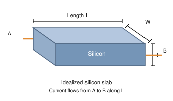

# Homework: Is an Intel i7 a Giant Silicon Resistor?

**Course:** Foundations of Analog and Digital Electronic Circuits  
**Reference:** Section 1.6  
**Topic:** Resistance, resistivity, geometry, and lumped-element models

## Objective

An Intel Core i7 processor contains billions of transistors fabricated on a thin silicon die.

In this assignment, we will ignore the transistors, metal interconnects, and other structures and treat the silicon substrate as a uniform rectangular conductor.

We will use the resistance formula:

$$
R = \rho \frac{L}{A}
$$

where:

- $R$ = resistance in ohms ($\Omega$)
- $\rho$ = resistivity in ohm-meters ($\Omega \cdot m$)
- $L$ = length of the conductor in meters
- $A$ = cross-sectional area in square meters

For a rectangular slab:

$$
A = Wt
$$

Therefore:

$$
\boxed{R = \rho \frac{L}{Wt}}
$$

where $W$ is the width and $t$ is the thickness of the silicon.

## Diagram

The diagram shows a rectangular slab of silicon. Electrical current flows from point A to point B along its length.

## Given

Assume the silicon has the following properties. These are illustrative values, not actual Intel specifications.

| Parameter | Value |
|---|---|
| Length ($L$) | 20 mm |
| Width ($W$) | 10 mm |
| Thickness ($t$) | 0.5 mm |
| Silicon resistivity ($\rho$) | 10 $\Omega \cdot cm$ |
| Applied voltage ($V$) | 1 V |

Assume uniform resistivity, ideal electrical contacts, and a constant temperature.

## Questions

### Part 1: Unit Conversions

**1.** Convert the following dimensions to meters:

- Length: 20 mm
- Width: 10 mm
- Thickness: 0.5 mm

**2.** Convert the silicon resistivity from $\Omega \cdot cm$ to $\Omega \cdot m$.

### Part 2: Calculate Resistance

**3.** Calculate the cross-sectional area through which electrical current flows.

Use:

$$
A = Wt
$$

**4.** Calculate the resistance between points A and B.

Use:

$$
R = \rho \frac{L}{A}
$$

Show each step of your calculation and include the correct units.

### Part 3: Apply Ohm's Law

**5.** Suppose we apply 1 V between points A and B.

Calculate the current flowing through the silicon.

Use:

$$
I = \frac{V}{R}
$$

Express your answer in milliamperes (mA).

### Part 4: Change the Geometry

**6.** Suppose the silicon thickness is reduced from 0.5 mm to 0.25 mm.

- Calculate the new resistance.
- Does resistance increase or decrease?
- Explain why.

**7.** Suppose the length of the silicon doubles while the width and thickness remain unchanged.

- Calculate the new resistance.
- Explain the relationship between length and resistance.

### Part 5: Semiconductor Doping

Pure silicon is a semiconductor. Engineers introduce impurities into silicon through a process called **doping** to change its electrical properties.

**8.** Suppose doping reduces the silicon resistivity by a factor of 1,000.

- Calculate the new resistivity.
- Calculate the new resistance using the original dimensions.
- Calculate the current at 1 V.

**9.** Does doping change the physical dimensions of the silicon in our simplified model? Explain why the electrical resistance changes.

### Part 6: Engineering Analysis

**10.** An actual Intel i7 processor contains billions of transistors.

Explain why the resistance calculated in this assignment does not represent the electrical resistance of an actual processor.

Consider:

- Different materials inside the processor
- Transistors that switch on and off
- Metal interconnections
- Regions of silicon with different doping levels

**11.** Our calculation assumes the silicon has uniform resistivity.

Why might this assumption be inaccurate for a real integrated circuit?

## Challenge Question

A processor can consume 65 W of electrical power.

Suppose, for simplicity, that it operates from a single 1 V power supply.

Using:

$$
P = \frac{V^2}{R}
$$

Calculate its effective resistance.

Compare this result with the resistance of the silicon slab calculated in Question 4.

**Why are the two values so different?**

Explain why the effective resistance calculated from power consumption is not the same as the physical resistance of the silicon substrate.

---

## What You Should Learn

After completing this assignment, you should understand:

1. How resistivity and geometry determine electrical resistance.
2. Why longer conductors have greater resistance.
3. Why increasing cross-sectional area reduces resistance.
4. How semiconductor doping affects resistivity.
5. Why a modern microprocessor cannot be modeled as a single fixed resistor.
6. The usefulness and limitations of simplified lumped-circuit models.

## Submission

Submit your answers in a Markdown file named:

`silicon_resistance_homework.md`

Include all calculations, units, and explanations. Show your work rather than providing only numerical answers.
