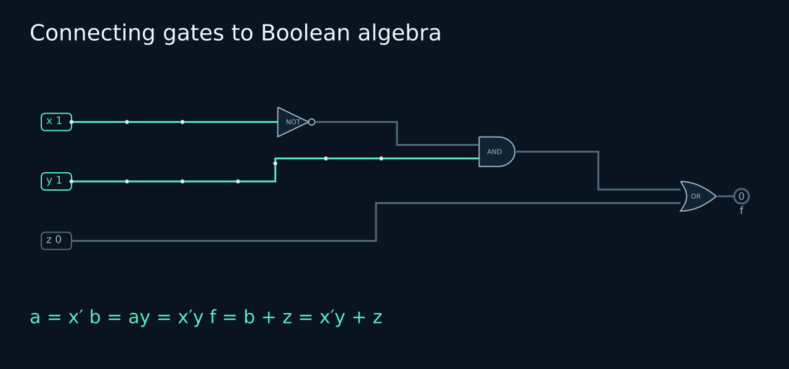

# Connecting Electric Circuits to Boolean Algebra

[Course home](../../boolean_logic.md) | [Previous: Switches and expressions](lesson_01.md) | [Next: Laws and proofs](lesson_02.md)

**Hypatia Academy teaching supplement. Time: 60–90 minutes.**

Begin with switches, wires, a supply, a current-limiting resistor and an LED. Establish the logic by tracing complete electrical paths. Only afterward introduce electronic gate symbols as a compact representation of already-understood behaviour.

Reference for switching algebra: J. Eldon Whitesitt, *Boolean Algebra and Its Applications*, Chapter 4. Animated powered circuits and this teaching sequence are Hypatia Academy adaptations; a later connection to modern electronic gate blocks is supplementary.

## 1. Parallel branches make OR visible



Connect two parallel wires, each with a switch, followed by one shared series resistor and LED, with a complete return to a low-voltage supply.

Let x and y describe their switches: 0 means open, 1 means closed. Let f say whether the switch network provides a complete conducting path. Do not use f to describe brightness or numerical current.

| x | y | Available path | f = x + y |
|---|---|---|---|
| 0 | 0 | Neither branch | 0 |
| 0 | 1 | Through y | 1 |
| 1 | 0 | Through x | 1 |
| 1 | 1 | Both branches available | 1 |

At 11 the condition “a path exists” remains true, so the Boolean output is 1. The plus sign represents OR, not arithmetic addition. **1 + 1 = 1** records a true conducting condition; it does not count paths.

## 2. Series contacts make AND visible

Place x and y in series. Every possible current path must pass through both contacts. The LED lights only when both close, so the condition is xy.

A permanent wire represents constant 1. A permanent break represents constant 0. These are physical continuity conditions in the switching model.

## 3. Prove the basic rules using paths

| Rule | Electrical explanation |
|---|---|
| x + 0 = x | A broken parallel branch cannot add a path |
| x1 = x | A permanent wire in series adds no restriction |
| x + 1 = 1 | A parallel wire bypasses the switch |
| x0 = 0 | A permanent series break blocks every path |
| x + x = x | Two linked parallel contacts still follow one control |
| xx = x | Two linked series contacts still follow one control |

For each rule, demonstrate x open and x closed. Those two cases are the complete proof for a single Boolean control.

Repeated labels are the **same linked control**. Do not independently operate two contacts labelled x and then apply xx = x.

## 4. Complementary contacts

A contact labelled x′ closes when x opens and opens when x closes. Use linked changeover contacts or correctly constrained simulated contacts, not independent pushbuttons.

| x | x′ | Parallel x + x′ | Series xx′ |
|---|---|---|---|
| 0 | 1 | 1 | 0 |
| 1 | 0 | 1 | 0 |

In parallel, one contact always provides a path. In series, one contact always breaks the path. Thus x + x′ = 1 and xx′ = 0.

## 5. Read a network before simplifying it

A series pair x and y is xy. A series pair x and z is xz. Put those branches in parallel: the complete condition is xy + xz.

Writing that expression is a translation of the existing wiring. It has not simplified anything yet.

Now factor:

```text
xy + xz = x(y + z)
```

Place one x contact before a parallel pair y and z. Four contact occurrences become three.

**Proof:** if x = 0 both networks block; if x = 1 both conduct exactly when y or z closes. These cases exhaust every value of x, whatever y and z do.

## 6. Remove a redundant branch

For x + xy, the xy branch cannot conduct unless the separate x branch already conducts.

```text
x + xy = x1 + xy = x(1 + y) = x1 = x
```

Three contact occurrences become one. Trace the actual paths after each change.

For xy + xy′:

```text
xy + xy′ = x(y + y′) = x1 = x
```

The complementary y pair always provides a path, so y can disappear from the final condition. Four contact occurrences become one.

## 7. De Morgan describes complementary networks

A series network xy conducts only at 11. The parallel complementary network x′ + y′ conducts in the other three cases. Their LED states are opposite, proving:

```text
(xy)′ = x′ + y′
```

A parallel network x + y fails to conduct only at 00. The series complementary network x′y′ conducts only at 00. Therefore:

```text
(x + y)′ = x′y′
```

To complement a series-parallel conducting condition, complement every contact and swap series with parallel. This does not mean a passive switch network independently produces an inverted voltage.

## 8. Exactly one: XOR

Build two parallel branches: x followed by y′, and x′ followed by y.

The first branch conducts only at 10; the second only at 01. Both branches are blocked at 00 and 11. The expression xy′ + x′y therefore describes exactly-one logic.

Compare ordinary parallel OR: at 11 the OR network conducts and the XOR network does not.

## 9. Six contacts become two

```text
xy + xy′ + x′z
= x(y + y′) + x′z
= x + x′z
= (x + x′)(x + z)
= x + z
```

The last step replaces an always-conducting factor by a wire. Compare all eight xyz assignments before accepting the final two-parallel-contact circuit.

The second distributive identity can be proved by cases: for x = 0, both x + yz and (x + y)(x + z) become yz; for x = 1, both become 1.

## 10. Connect this understanding to electronic gates later

Once students can explain series and parallel paths, show AND, OR and NOT symbols as compact descriptions of the same truth tables. Electronic gates use transistor circuits, not stored program instructions. Their voltage behaviour requires a different physical implementation from passive contacts.

Boolean reasoning also underlies digital design and logic synthesis. CPU implementations add timing, power, area and component constraints. Contact counts are not chip counts or transistor counts.

## Student exercises

1. Draw powered circuits for x + y, xy, x + 0 and x1. Include the shared resistor, LED and return connection.
2. Explain Boolean 1 + 1 = 1 by opening and closing the two parallel contacts.
3. Draw x + xy and its simplified circuit. Give the proof and all four input cases.
4. Build linked complementary-contact networks for x + x′ and xx′. Explain why they behave differently.
5. Draw xy + xy′ and simplify it to x, keeping repeated controls linked.
6. Draw both De Morgan pairs. Verify that the original and complementary networks have opposite outputs in all four rows.
7. Disprove xy + z = x(y + z) with x = 0, y = 0, z = 1.

### Teacher checks

1–2: use series for AND, parallel for OR; 0 is a break and 1 is a wire. Both parallel contacts closed still makes the existence-of-a-path condition true.

3: x + xy = x; outputs in xy order 00, 01, 10, 11 are 0, 0, 1, 1. 4: parallel always conducts, series never conducts. 5: factor x and use y + y′ = 1. 6: outputs are complementary, not equal. 7: the original conducts through z, but the proposed x contact blocks every path.

## Physical scope

Use a low-voltage supply and an appropriately sized current-limiting resistor shared in series with the LED. Ideal continuity does not calculate current, LED brightness, contact resistance or transient effects. Two networks can be Boolean-equivalent without having identical electrical properties.
