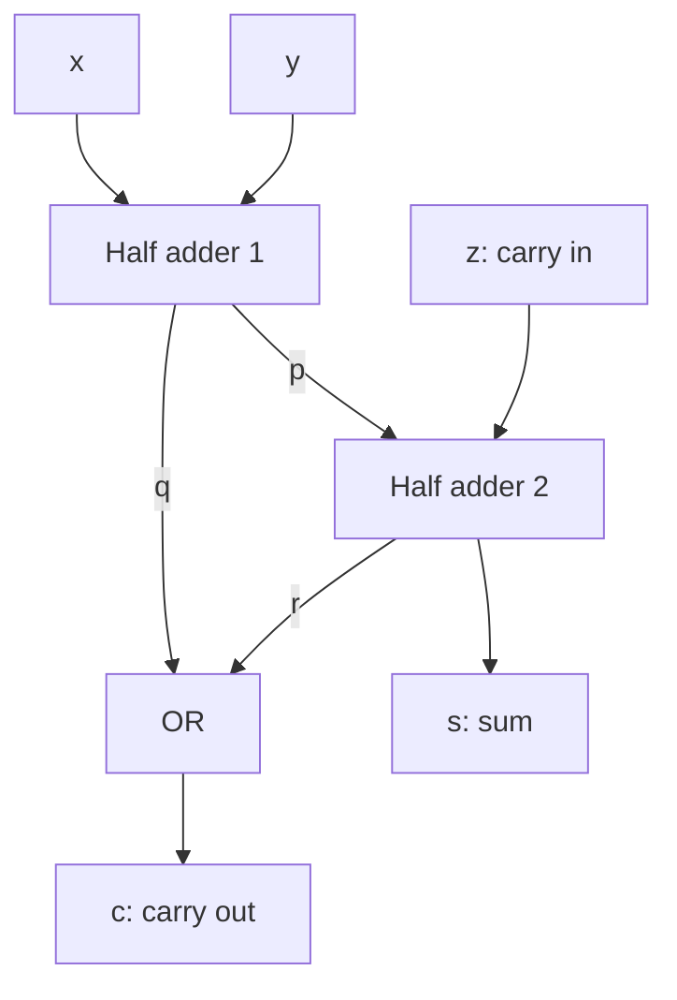

# Lesson 6: Build a full adder from two half adders

[Course home](../../boolean_logic.md) | [Previous](lesson_05.md) | [Next](lesson_07.md)

**Reading:** Whitesitt 6-4, pp. 143–145, including the full-adder exercise. **Time:** 120 minutes.

## Goals

Include an incoming carry, derive sum and carry functions, and combine two half adders with an OR gate.

## 1. Why a half adder is not enough (15 minutes)

In a multi-column addition a column can receive three bits: x, y and an incoming carry z. Their ordinary arithmetic total can be zero, one, two or three.

A full adder takes these three bits. It returns sum s and outgoing carry c. The two-bit number cs represents the total. Here z is carry-in and c is carry-out; they are different wires.

## 2. Derive the truth table (20 minutes)

| x | y | z | s | c |
|---|---|---|---|---|
| 0 | 0 | 0 | 0 | 0 |
| 0 | 0 | 1 | 1 | 0 |
| 0 | 1 | 0 | 1 | 0 |
| 0 | 1 | 1 | 0 | 1 |
| 1 | 0 | 0 | 1 | 0 |
| 1 | 0 | 1 | 0 | 1 |
| 1 | 1 | 0 | 0 | 1 |
| 1 | 1 | 1 | 1 | 1 |

The sum is 1 for an odd number of input 1s. The carry is 1 when at least two inputs are 1.

s = x'y'z + x'yz' + xy'z' + xyz.

c = x'yz + xy'z + xyz' + xyz = xy + xz + yz.

To prove the carry simplification, repeat xyz as needed using idempotence, then pair each of the other three terms with one copy. For example xy'z + xyz = xz.

## 3. Two half adders (25 minutes)

Let the first half adder receive x and y:

- p = xy' + x'y
- q = xy

Let the second receive p and z:

- s = pz' + p'z
- r = pz

The final carry is c = q + r. Equivalently, c = xy + z(xy' + x'y). It equals the majority form xy + xz + yz.

There is no feedback or memory in this circuit. Once inputs stop changing and gate delays have passed, outputs settle to the required result.

## 4. Build and verify (45 minutes)

Connect two tested half-adder blocks and an OR gate. Test all eight rows. For each row, compare cs with the ordinary arithmetic total.

Trace 111 explicitly: the first half adder gives p = 0 and q = 1; the second gives s = 1 and r = 0; therefore c = 1. The answer is 11, meaning three, not a two-bit overflow error.

Explain why q and r cannot both be 1: q = 1 forces x = y = 1, which forces p = 0, which forces r = 0.

## 5. Exit check (15 minutes)

What is the difference between a half and full adder? Why is the carry function a majority condition? What does the full adder output for 101?

**Homework:** [Arithmetic exercises](exercises.md), R4–R6.
