# Circuit diagrams

SVG files render directly in GitHub Markdown. White backgrounds preserve readability in dark mode.

Switch diagrams show ideal conducting paths between A and B, not full powered circuits. Contact positions are symbolic. Gate diagrams use IEC rectangular symbols and named-wire connections.

## Absorption

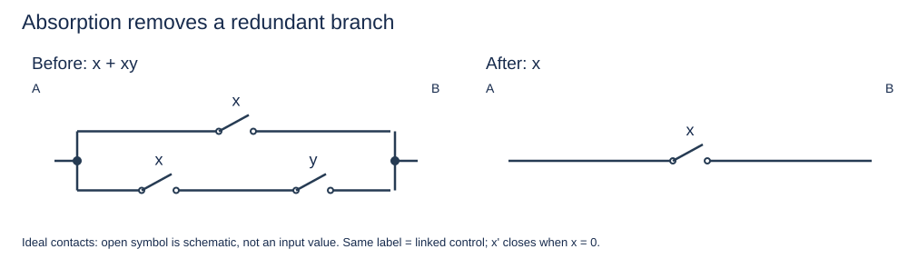

## Complements

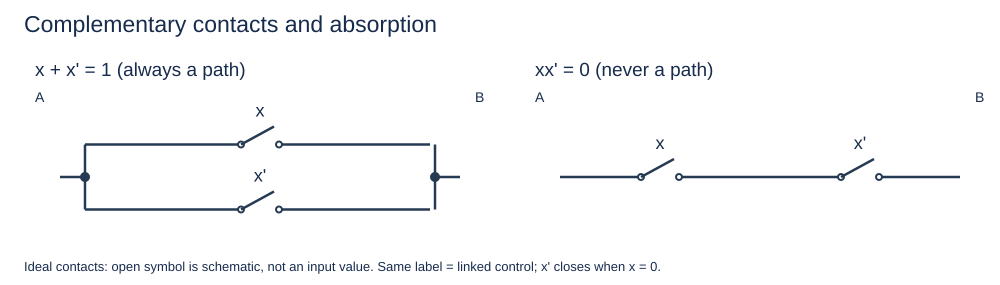

## Compound

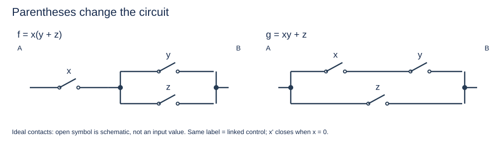

## Design

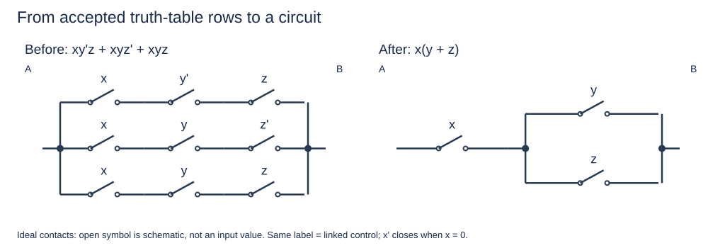

## Factor

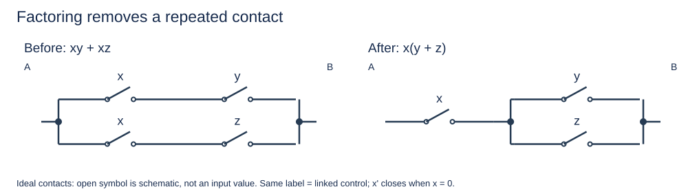

## Full Adder

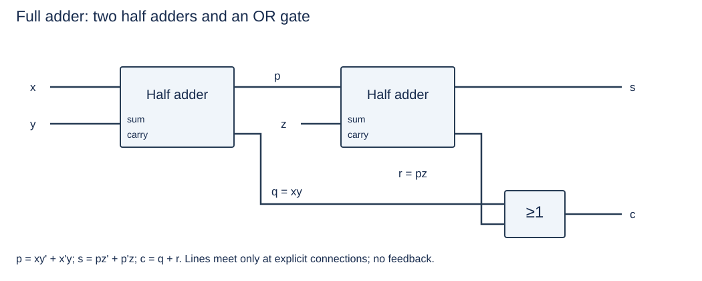

## Half Adder

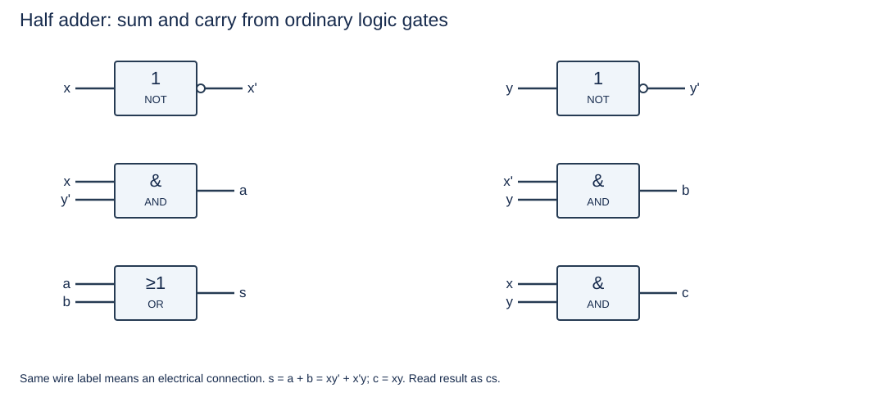

## Nand Full

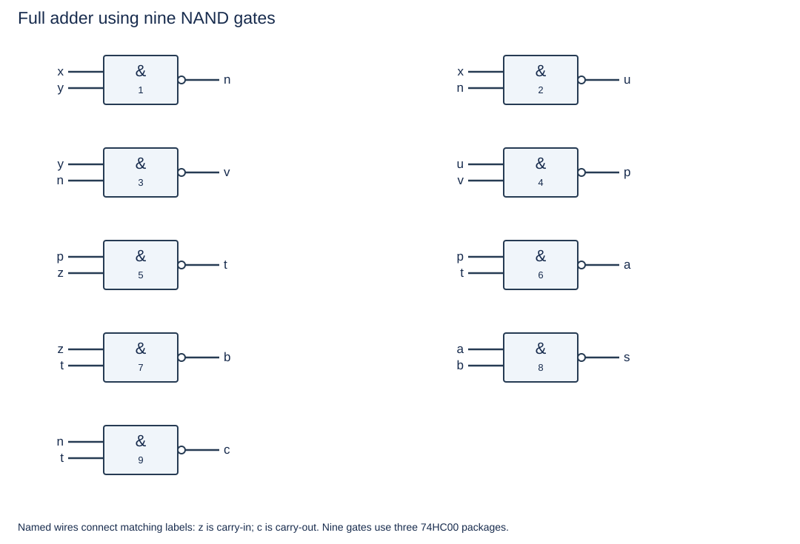

## Nand Half

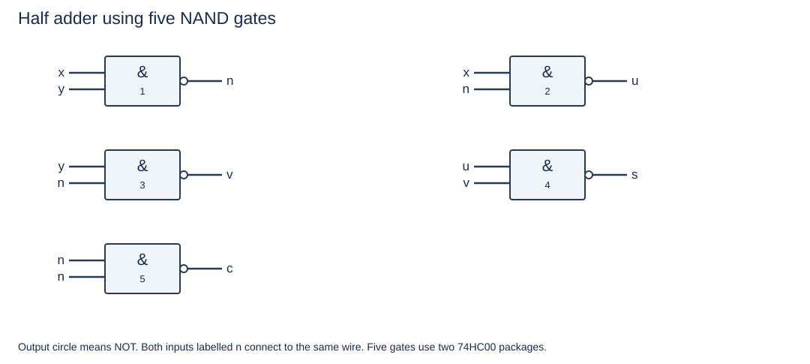

## Ripple Adder

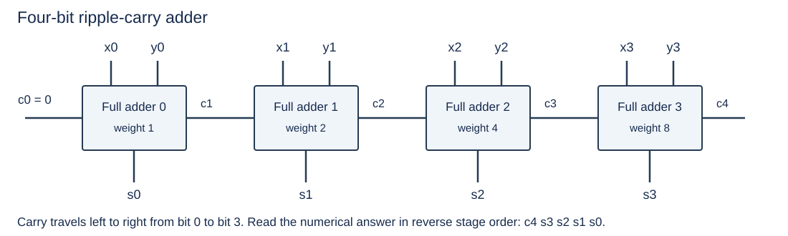

## Series Parallel

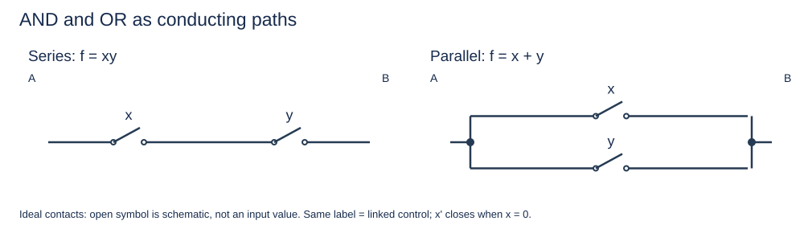

## Simplify

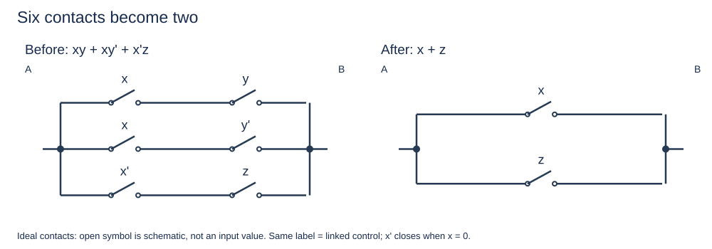

## Xor Contacts

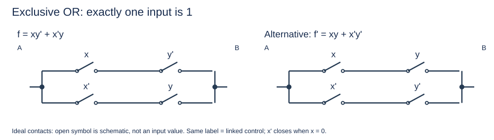

